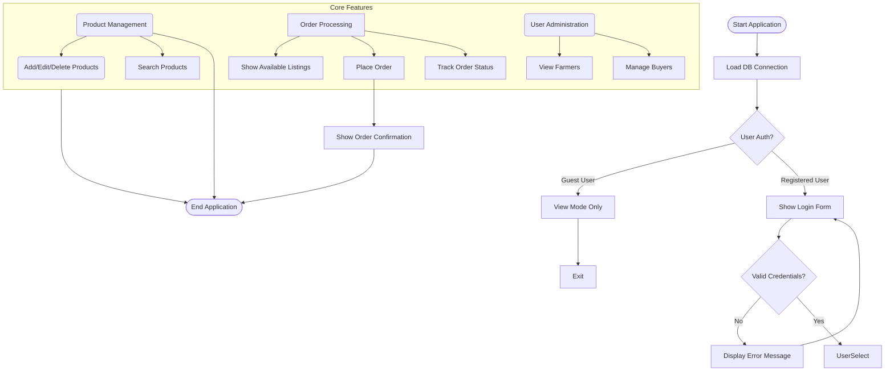

# FarmDirect Micro Project - Diagrams

## 1️⃣ Use Case Diagram

```mermaid
usecaseDiagram
    actor Farmer as "Farmer/FPO"
    actor Buyer as "Buyer (Individual)"
    actor BulkCustomer as "Bulk Buyer (Restaurant/Store)"
    actor Admin as "Admin/Manager"

    package "Main System Application" {
        usecase "Register/Login" <<include>> uc1
        
        usecase "View Product Listings" as uc2
        usecase "Add New Product Listing" as uc3
        
        usecase "View Buyer List" as uc4
        usecase "Place Order to Farmers" as uc5
        usecase "Track Delivery Status" as uc6
        
        usecase "List All Registered Users" as uc7
        usecase "Manage Inactive Accounts" as uc8
    }

    Farmer --> uc3 : Can add product listings
    Buyer --> uc2 : Browse available products
    Buyer --> uc5 : Place individual orders
    
    BulkCustomer --> uc5 : Bulk order placement
    
    Admin --> uc1 : System login/access
    Admin --> uc7 : View all user accounts
    Admin --> uc8 : Deactivate/unlock accounts

    note right of uc2 : Search by category\nView prices & quantities
    
    note right of uc5 : See farmer details\nOrder status tracking
```

## 2️⃣ Flowchart Diagram



---

**Note:** These diagrams are ready to be included in your final project report. They clearly show the system requirements for your Java GUI + JDBC micro project.
